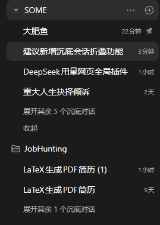
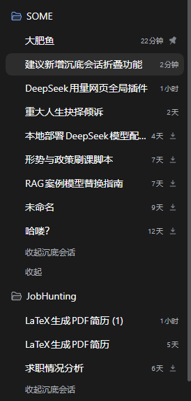
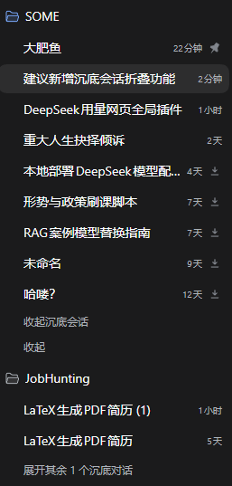

# dsh-sink-sessions（沉底会话）

把会话**沉到所在工作区的最底部**——置顶的反向操作。沉底后该会话从分组的正常阅读顺序里折叠出去，需要时才展开回来。

[English](README.en.md) | 中文

```
📁 SOME
   大肥鱼                        23 小时   📌
   DeepSeek 用量网页全局…          47 分钟   📌
   重大人生抉择倾诉                2 天     📌
   本地部署 DeepSeek 模型配置…      4 天     ↓     ← 已沉底，行尾有标记
   形势与政策刷课脚本               7 天     ↓
   展开其余 2 个沉底对话                          ← 本插件
   展开其余 3 个会话                              ← 原生 watermark 行
```

| 折叠态 | 展开态 | 每个工作区各存各的状态 |
| :---: | :---: | :---: |
|  |  |  |

## 新增了什么

| 位置 | 行为 |
| --- | --- |
| 会话 **“...” 菜单** | `沉底会话` / `取消沉底`，`order` 150——正好在原生「置顶会话」下面、「重命名」上面。 |
| **行尾标记** | 相对时间后面一个 14px 的「向下箭头落进托盘」小图标，座位、尺寸、颜色都和原生小钉子一致，带 `aria-label` / 悬停提示「已沉底」，不打开菜单也能一眼认出。 |
| **分组展开行** | `展开其余 N 个沉底对话`，固定在原生分组控制行（`展开其余 N 个会话` / `收起`）之上；展开后就地显示该组的沉底行，文案变成 `收起沉底会话`，不会和原生的「收起」重名。 |
| **持久化** | 沉底集合按浏览器存在 `localStorage`（键 `dsh-sink-sessions.v1`）；展开状态是临时的，刷新后默认折叠（和原生 watermark 一样）。 |

置顶与沉底互为反向：置顶把行提到分组最前，沉底把行折到分组阅读顺序的最末。

## 环境要求

- DeepSeek Harness 的 Web 客户端，需存在 `@deepseek-ai/dsh-client-ui-workspace` 与
  `@deepseek-ai/dsh-client-ui-sidebar`（桌面版标准 profile 自带）。
- 在 **0.2.1-rc.3**（桌面版 / Windows）上开发与验证。插件读取的是侧边栏已渲染的列表，
  未来版本若改动该 DOM 契约，隐藏会失效（不会崩溃）——见「限制」。

## 安装

本地检出后：

```bash
git clone https://github.com/<your-account>/<repo>.git
dsh plugin install ./<repo>
```

或用 Plugin Manager 指向本目录（插件页 → 安装 bundle → 本地目录）。装完 **刷新页面**（`Ctrl+R`）：
Client 半是随页面加载的。

验证：任意会话的 `...` 菜单里，`沉底会话` 应该正好在 `置顶会话` 下面。

### 卸载

```bash
dsh plugin remove dsh-sink-sessions
```

或从 profile 的 `dsh.profile.bundles` 与 `dependencies` 里删掉 `dsh-sink-sessions`。
`localStorage` 里残留的沉底 id 只在 `dsh-sink-sessions.v1` 这一个键下，可一并清除。

## 限制

这是一个**UI 层扩展，不是原生列表功能**。原生浏览器独占行派生与每组 watermark，只开放了
菜单行、悬停按钮、行首装饰、悬停卡片几个座位，没有「过滤/重排已渲染行」的钩子。因此：

- **原生计数仍含沉底行**：原生 `展开其余 N 个会话` 数的是 watermark 隐藏的行，沉底行也算在内，
  所以它的数字可能大于实际展开出来的行数；插件自己那行只数沉底行。
- **展开不重排**：沉底行回到原来的时间位置，不会移动到普通行下面。要真正“沉到组尾”需要原生改动。
- **依赖两个结构事实**：行是 `[data-row-key="session:<id>"]`，且某分组自己的会话行是承载
  `[data-row-key="workspace:<key>"]` 元素的直接子节点。任一被改动，隐藏会失效（不崩溃）。
- **扁平（“一条列表”）视图**没有分组可折，只在列表末尾给一行全局展开。
- **仅 Web 客户端**：Client 半声明为 `dsh.client.platform: web`。

## 实现方式

- 菜单行就是普通的 `sidebar.workspaces.session.menu.item` 注册，排在 Pin（100）与 Rename（200）之间。
- `MutationObserver` 让渲染出来的列表与状态同步：沉底行加内联 `display: none`（React 不会在这些行上设
  `display`）和 `data-sink-hidden`，并向分组里放入一个标记元素和一个展开 `button`；两者都做了幂等判断，
  React 重渲染不会产生重复节点。
- 无网络请求、无遥测、无 Host 侧状态。唯一存储的是 `localStorage` 里的沉底会话 id 集合。

## 开发

Client 半是单文件、无构建步骤：

```
package.json          bundle 清单（dsh.bundle.patch + dsh.client）
cordis.patch.yml      插入 Host 行
index.js              Host 半：export function apply() {}
client.js             全部 UI：状态、DOM 同步、菜单行、展开行、行尾标记
locale/en.json        Plugin Manager 展示元数据
locale/zh.json
icon.svg
```

目录布局遵循 Harness 插件约定：Host 行挂载包，`dsh.client` 把 `client.js` 送到浏览器，
Client 半通过 `ctx.slots.inject` 注册进座位。

## License

MIT，见 [LICENSE](LICENSE)。
